# HA Weather Dynamic Background

[](https://hacs.xyz/docs/faq/custom_repositories/)
[](https://github.com/michaldyr/ha-weather-dynamic-background-card/releases)

[🇬🇧 English](README.md) · 🇵🇱 Polski

Żywe tło dashboardu Home Assistant. Niebo za kartami odpowiada prawdziwej pogodzie, położeniu słońca i fazie księżyca.

To karta Lovelace, która na dashboardzie jest niewidoczna. Dodajesz ją do widoku, a ona maluje za wszystkimi kartami animowane niebo:
- miękki pokład chmur dryfujący z wiatrem,
- deszcz pod skosem z kroplami spływającymi po szybie, śnieg, burzę z piorunami i mgłę,
- gwiazdy, księżyc i spadające gwiazdy,
- tęczę po deszczu, szron przy mrozie, smog, a nawet zorzę.

<p align="center">
  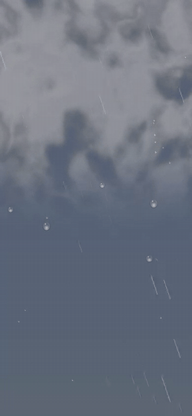
  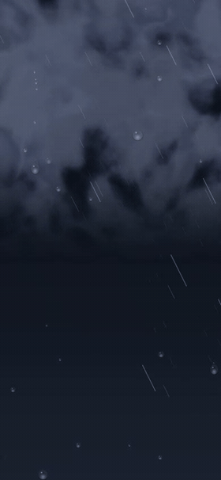
  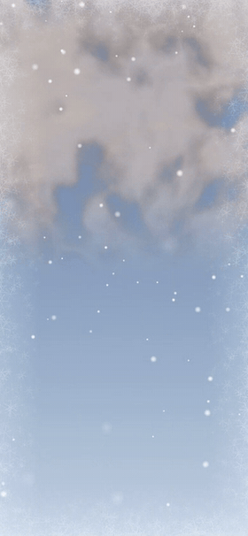
  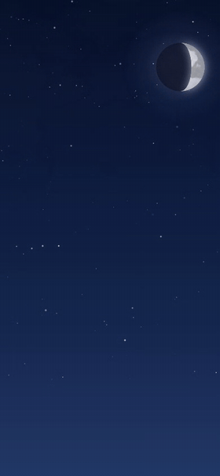
</p>

| Słonecznie, motyw jasny | Deszcz, motyw ciemny |
|---|---|
| 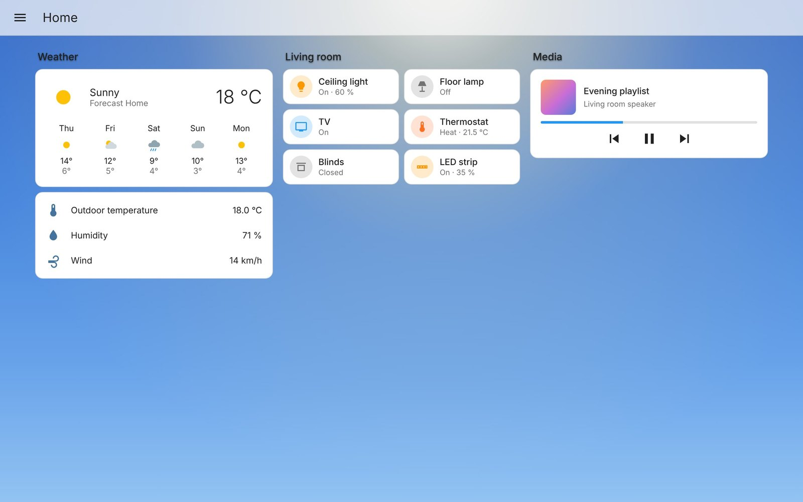 | 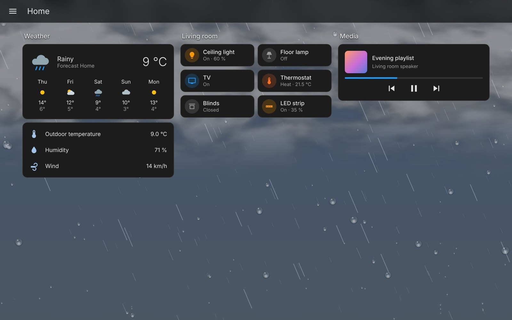 |
| **Złota godzina** | **Bezchmurna noc** |
| 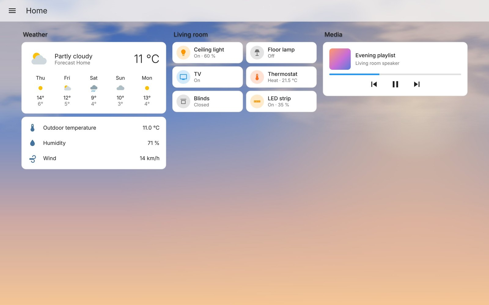 | 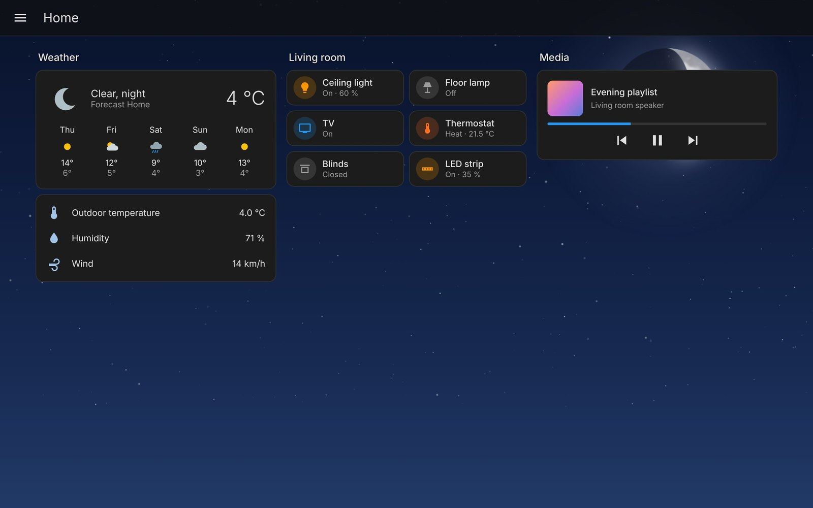 |

> Zrzuty i animacje powstały na stronie testowej, która naśladuje domyślne karty Home Assistant i podaje karcie symulowane dane pogodowe. Nie są to zrzuty z prawdziwej instalacji Home Assistant.

---

## Spis treści

- [Możliwości](#możliwości)
- [Instalacja](#instalacja)
- [Szybki start](#szybki-start)
- [Konfiguracja](#konfiguracja)
- [Ustawienia urządzenia i panel podglądu](#ustawienia-urządzenia-i-panel-podglądu)
- [Skąd bierze się niebo](#skąd-bierze-się-niebo)
- [Galeria efektów](#galeria-efektów)
- [Półprzezroczyste karty (opcjonalnie)](#półprzezroczyste-karty-opcjonalnie)
- [Zmienne CSS dla motywów](#zmienne-css-dla-motywów)
- [Dostępność i wydajność](#dostępność-i-wydajność)
- [Rozwiązywanie problemów](#rozwiązywanie-problemów)
- [Ograniczenia](#ograniczenia)
- [Podobne projekty](#podobne-projekty)

## Możliwości

- **Prawdziwe kolory nieba.** Gradient płynnie podąża za wysokością słońca: noc, niebieska godzina, świt, złota godzina, dzień. Poświata słońca wędruje ze wschodu na zachód zgodnie z jego azymutem.
- **Wszystkie stany pogody HA.** Słonecznie, częściowe zachmurzenie, pochmurno, mgła, deszcz, ulewa, burza, śnieg, deszcz ze śniegiem, grad, wietrznie i warunki wyjątkowe.
- **Realistyczne chmury.** U góry nieba wisi miękki, nakrapiany pokład chmur, który rzednie ku dołowi. Jest generowany proceduralnie z szumu, a nie rysowany jako kształty. Dwie warstwy dryfują z wiatrem z różną prędkością. Im większe zachmurzenie, tym pokład gęstszy i schodzi niżej. Chmury są białe na błękitnym niebie, szare przy zachmurzeniu, ciemne przy deszczu i granatowoszare w nocy. Przy złotej godzinie robią się ciepłe, rozświetlają je błyskawice i zasłaniają księżyc.
- **Deszcz na szybie.** Podczas deszczu krople osiadają na „szybie” przed niebem; większe spływają i zostawiają drobne kropelki.
- **Głębia.** Deszcz pada w trzech planach, a śnieg ma duże, nieostre płatki tuż „przed obiektywem”.
- **Sterowane Twoimi danymi.**
  - Zachmurzenie ustala gęstość pokładu chmur i to, jak nisko schodzi.
  - Prędkość i kierunek wiatru ustalają kąt deszczu, dryf śniegu i prędkość chmur.
  - Widoczność dodaje mgiełkę.
  - Opcjonalny sensor opadu ustala gęstość deszczu.
- **Nocne niebo.** Migoczące gwiazdy, co jakiś czas spadająca gwiazda i księżyc w prawdziwej fazie. Fazę karta liczy astronomicznie, więc integracja Moon nie jest potrzebna. Księżyc płynnie przygasa za gęstniejącymi chmurami.
- **Dodatki opcjonalne.**
  - Tęcza po deszczu przy nisko stojącym słońcu.
  - Szron na krawędziach ekranu poniżej 0 °C.
  - Smog z czujnika PM2.5.
  - Zorza tylko podczas prawdziwych burz geomagnetycznych, wystarczająco silnych dla Twojej szerokości geograficznej.
  - Kolorowa poświata przy ostrzeżeniach pogodowych.
- **Działa z motywem jasnym i ciemnym.** Niebo pokazuje rzeczywistość, a motyw tylko je koryguje: w ciemnym przygasza jasne niebo, a w jasnym rozjaśnia ciemne.
- **Spokojne zmiany sceny.** Nowy stan pogody musi się utrzymać przez ustawiony czas, domyślnie 10 minut. Dopiero wtedy scena się zmienia, płynnie przenikając.
- **Ustawienia per urządzenie.** Tablet ścienny i telefon mogą mieć różne ustawienia animacji i jakości.
- **Dostępność.** Respektuje *Ogranicz ruch* i *Zmniejsz przezroczystość* oraz zatrzymuje się, gdy karta przeglądarki jest w tle.
- **Jeden plik JavaScript, bez zależności.** Interfejs po polsku i angielsku.

## Instalacja

Kartę instaluje się przez [HACS](https://hacs.xyz) jako repozytorium niestandardowe.

1. Otwórz **HACS**, a potem **⋮ → Niestandardowe repozytoria**.
2. Wpisz `https://github.com/michaldyr/ha-weather-dynamic-background-card`, wybierz typ **Dashboard** i kliknij **Dodaj**.
3. Znajdź w HACS **HA Weather Dynamic Background** i pobierz.
4. Odśwież przeglądarkę. W aplikacji mobilnej wyczyść pamięć podręczną frontendu w ustawieniach debugowania aplikacji.

HACS przechowuje kartę w `/config/www/community/ha-weather-dynamic-background-card/` i udostępnia ją jako `/hacsfiles/ha-weather-dynamic-background-card/ha-weather-dynamic-background-card.js`. Przy dashboardach w domyślnym trybie (UI) HACS sam dodaje ten zasób. Jeśli dashboardy są w trybie YAML, dodaj go samodzielnie jako zasób typu `module`.

Aktualizacje również przychodzą przez HACS.

## Szybki start

Dodaj kartę do każdego widoku, który ma mieć niebo. Miejsce nie ma znaczenia; najwygodniej na końcu widoku.

```yaml
type: custom:ha-weather-dynamic-background-card
weather_entity: weather.forecast_dom
```

Karta nie zajmuje miejsca na dashboardzie. W trybie edycji pokazuje panel ustawień z podglądem scen na żywo. W wyborze kart występuje jako **HA Weather Dynamic Background**.

## Konfiguracja

Wszystko da się ustawić w edytorze wizualnym. Opcje YAML:

| Opcja | Domyślnie | Opis |
|---|---|---|
| `weather_entity` | — | **Wymagana.** Twoja encja `weather.*`. |
| `sun_entity` | `sun.sun` | Encja słońca (wysokość i azymut). |
| `precipitation_entity` | — | Opcjonalny sensor bieżącego opadu w mm/h; ustala gęstość deszczu. |
| `pm25_entity` | — | Opcjonalny czujnik PM2.5 (µg/m³) do smogu. |
| `kp_entity` | — | Opcjonalny sensor z planetarnym indeksem Kp do zorzy. |
| `warning_entity` | — | Opcjonalna encja ostrzeżeń (np. Meteoalarm), zob. [Galeria efektów](#galeria-efektów). |
| `pause_entity` | — | Opcjonalny `binary_sensor`, `input_boolean` lub `switch`. Gdy jest `on`, tło stoi w miejscu: zostaje ostatnia klatka, nic nie jest rysowane, animacje CSS i timery tła się zatrzymują, a zmiany pogody, jakości lub rozmiaru czekają na wyłączenie. Z myślą o wygaszaczu ekranu w kiosku rysowanym nad stroną: strona nie jest ukryta, więc karta sama tego nie wykryje. Podczas pauzy karta nadal raz na minutę odczytuje stany z Home Assistanta. Aby pauzować, gdy encja jest `off` (przełącznik „ekran włączony”), użyj szablonowego binary sensora. |
| `battery_saver` | `false` | Przy jakości urządzenia *Automatyczna* rysuje w jakości *Oszczędna*, gdy urządzenie nie jest ładowane. Wymaga przeglądarki, która podaje stan baterii (`navigator.getBattery()`, przeglądarki oparte na Chromium przez HTTPS); w innych nic nie robi. |
| `animations` | `true` | Animacje deszczu, śniegu, chmur, gwiazd i piorunów. |
| `intensity` | `100` | Gęstość opadów, 20–200 %. |
| `hysteresis` | `10` | Ile minut nowy stan pogody musi się utrzymać, zanim zmieni się scena. `0` oznacza natychmiast. |
| `dark_dim` | `40` | Przyciemnienie jasnego nieba w motywie ciemnym, %. |
| `light_lift` | `10` | Rozjaśnienie ciemnego nieba w motywie jasnym, %. |
| `lightning_flash` | `true` | Błyski nieba podczas burzy. Przy *Ogranicz ruch* są zawsze wyłączone. |
| `show_moon` | `true` | Księżyc. |
| `show_stars` | `true` | Gwiazdy. |
| `show_shooting_stars` | `true` | Spadające gwiazdy przy bezchmurnej nocy. |
| `sun_azimuth` | `true` | Poświata słońca wędruje z azymutem. |
| `show_rainbow` | `true` | Tęcza po deszczu. |
| `show_frost` | `true` | Szron na krawędziach poniżej 0 °C. |
| `show_panel` | `false` | Panel ustawień i podglądu widoczny także poza trybem edycji, przydatny przy testach. |

Pełny przykład:

```yaml
type: custom:ha-weather-dynamic-background-card
weather_entity: weather.forecast_dom
precipitation_entity: sensor.opad
pm25_entity: sensor.airly_pm2_5
kp_entity: sensor.planetary_k_index
warning_entity: binary_sensor.meteoalarm
intensity: 120
hysteresis: 15
dark_dim: 45
```

Nazwy encji w przykładzie to tylko przykłady; wpisz własne.

## Ustawienia urządzenia i panel podglądu

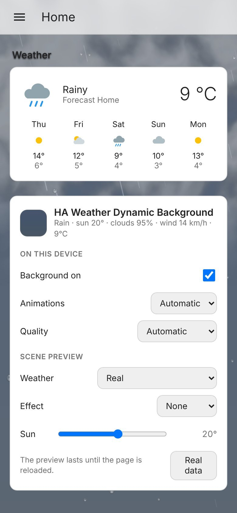

W trybie edycji albo przy `show_panel: true` karta pokazuje panel. Interfejs dostosowuje się do języka Home Assistant.

**Na tym urządzeniu.** Te ustawienia zapisują się w przeglądarce, więc każde urządzenie ma własne:

- **Tło włączone**: wyłącza tło tylko na tym urządzeniu.
- **Animacje**:
  - *Automatycznie* respektuje systemowe *Ogranicz ruch*.
  - *Zawsze* animuje mimo tego ustawienia.
  - *Wyłączone* pokazuje statyczną scenę.
- **Jakość**:
  - *Automatyczna* sama zmniejsza liczbę cząsteczek, gdy urządzenie nie nadąża.
  - *Oszczędna* jest przeznaczona dla starszych tabletów.
  - *Wysoka* daje 60 kl./s i pełną rozdzielczość.

**Podgląd scen.** Możesz wymusić dowolną pogodę, efekt i wysokość słońca, żeby obejrzeć wszystkie warianty bez czekania na pogodę. Podgląd działa do odświeżenia strony.

Linia w nagłówku pokazuje, co karta aktualnie odczytuje: stan, wysokość słońca, zachmurzenie, wiatr, oświetlenie księżyca i oczekującą zmianę sceny.

<br clear="right">

## Skąd bierze się niebo

| Dane | Źródło | Na co wpływa |
|---|---|---|
| Wysokość słońca | `sun.sun` → `elevation` | Gradient nieba: noc → niebieska godzina → świt → złota godzina → dzień, płynnie. |
| Azymut słońca | `sun.sun` → `azimuth` | Poświata rano z lewej, w południe na środku, wieczorem z prawej; niżej, gdy słońce jest nisko. |
| Stan pogody | stan `weather.*` | Scena: paleta, chmury, opady, pioruny, mgła. |
| Zachmurzenie | atrybut `cloud_coverage` | Liczba, gęstość i odcień chmur; przygaszenie nieba; widoczność księżyca. |
| Wiatr | `wind_speed`, `wind_bearing` | Kąt deszczu, dryf śniegu, prędkość i kierunek chmur. |
| Widoczność | atrybut `visibility` | Mgiełka. |
| Temperatura | atrybut `temperature` | Szron poniżej 0 °C, najgęstszy ok. −6 °C. |
| Faza księżyca | liczona | Kształt i jasność księżyca; na półkuli południowej odbity. |
| Niedawny deszcz | historia pogody w przeglądarce | Tęcza do 30 minut po deszczu. |
| PM2.5 | `pm25_entity` | Smog od ok. 25 µg/m³, gęsty powyżej ok. 130 µg/m³. |
| Indeks Kp | `kp_entity` + Twoja szerokość geograficzna | Zorza tylko przy Kp wystarczającym dla Twojej szerokości (w Polsce ok. Kp 7–8), w nocy i przy czystym niebie. |
| Ostrzeżenia | `warning_entity` | Żółta, pomarańczowa lub czerwona poświata u góry ekranu. |
| Motyw | tryb jasny/ciemny HA | Przyciemnienie lub rozjaśnienie nieba, żeby karty były czytelne. |

Gdy integracja pogodowa nie podaje jakiegoś atrybutu, karta używa wartości typowych dla danego stanu. Domyślna integracja Met.no podaje zachmurzenie, wiatr i temperaturę.

**Ostrzeżenia pogodowe.** Karta odczytuje stopień ze stanu albo z atrybutów `awareness_level`, `level`, `severity` lub `color`. Rozumie `yellow`, `orange` i `red` (także po polsku), `moderate`, `severe` i `extreme` oraz liczby 1–3. Każdy inny stan „włączony” traktuje jako stopień 1. To obejmuje integrację Meteoalarm z rdzenia HA i większość innych źródeł.

## Galeria efektów

Samo niebo, bez dashboardu na wierzchu:

| Częściowe zachmurzenie | Pochmurno | Deszcz | Burza |
|---|---|---|---|
| 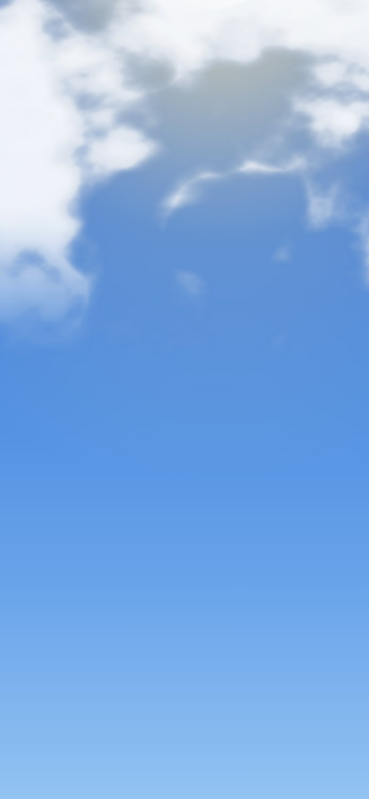 | 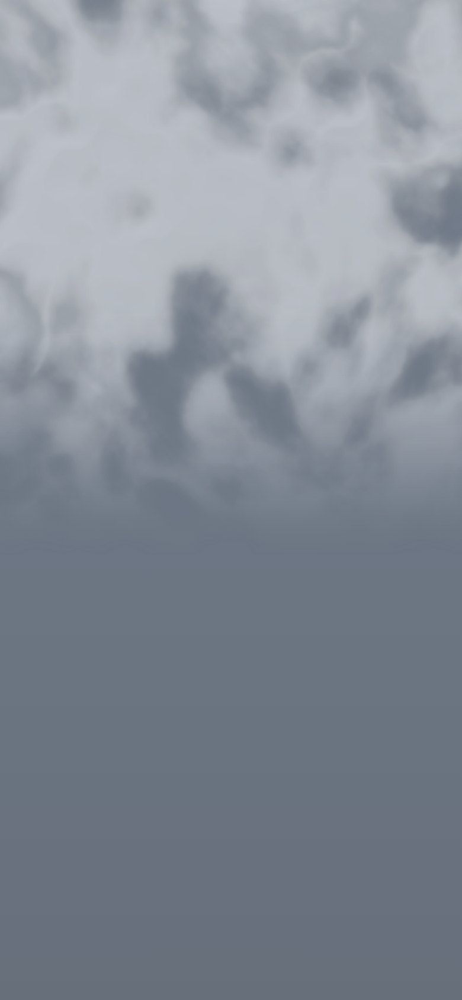 | 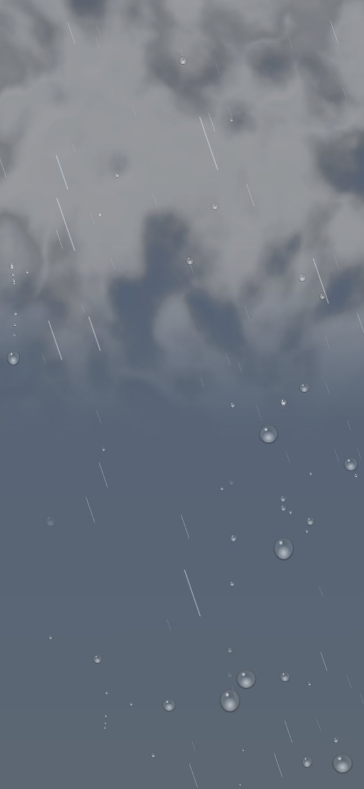 | 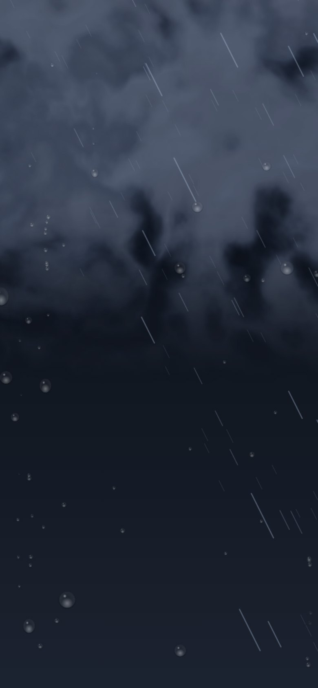 |
| **Śnieg** | **Mgła** | **Złota godzina** | **Bezchmurna noc** |
| 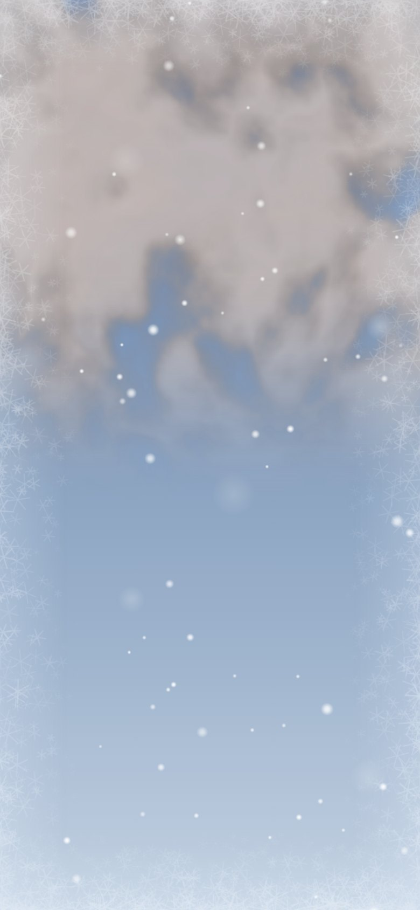 |  | 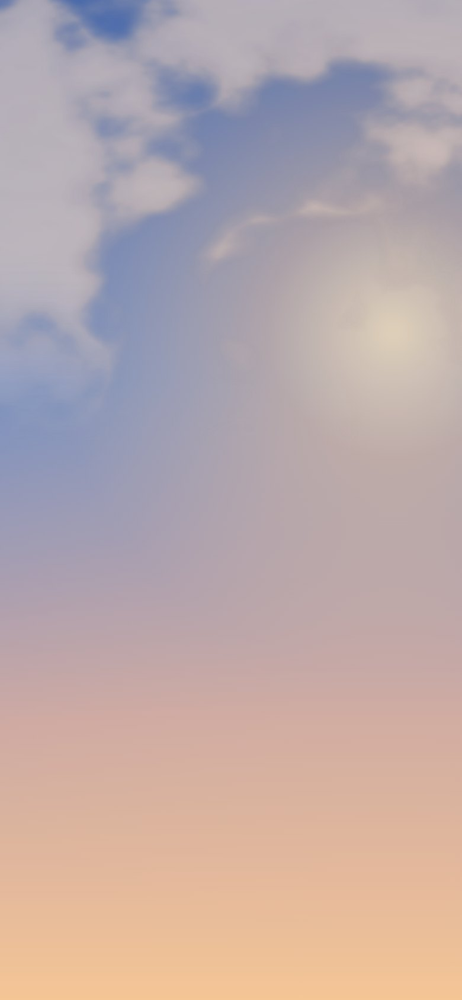 | 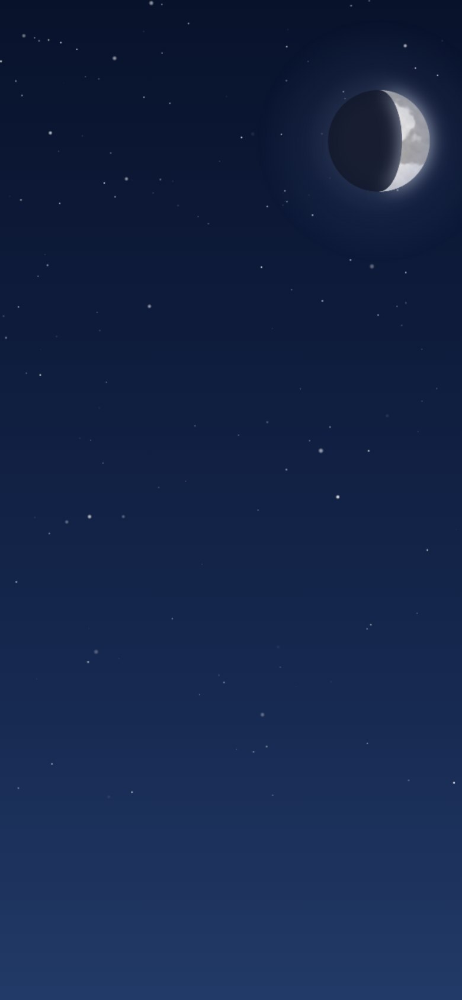 |
| **Tęcza** | **Szron** | **Smog** | **Zorza** |
| 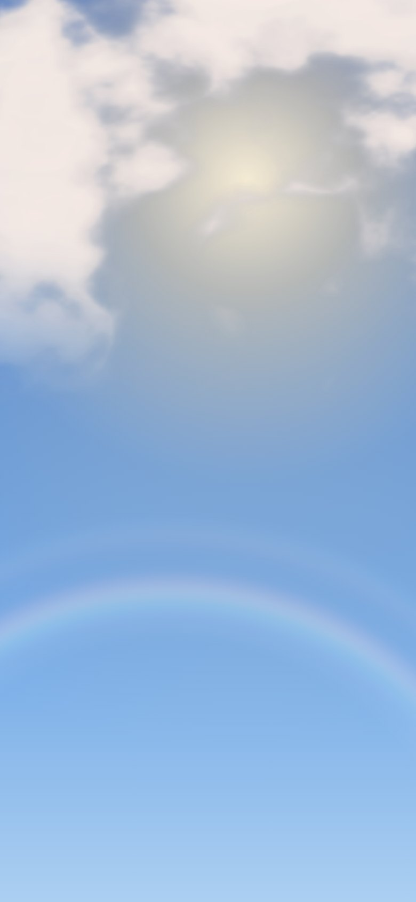 | 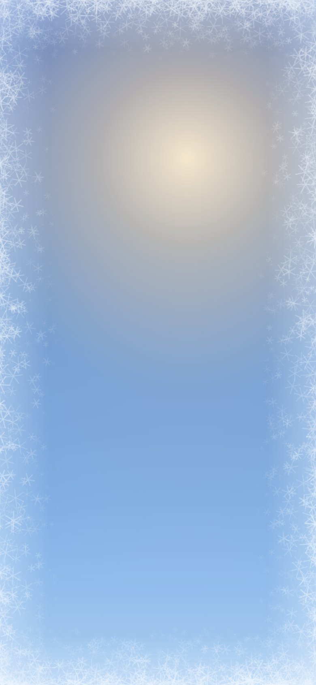 | 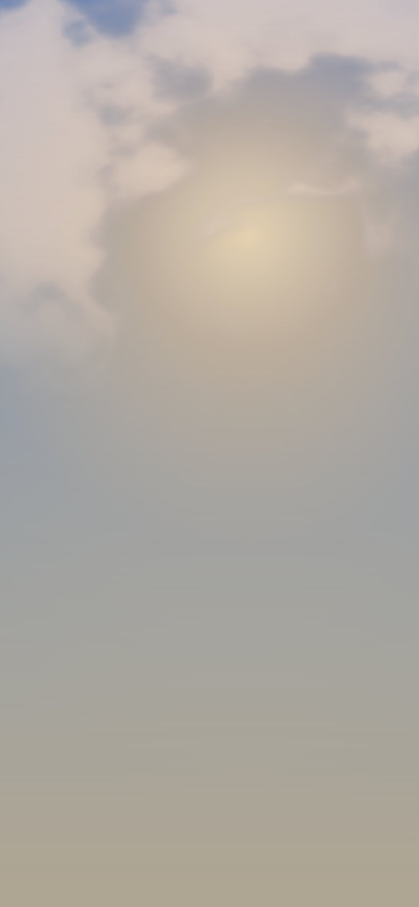 | 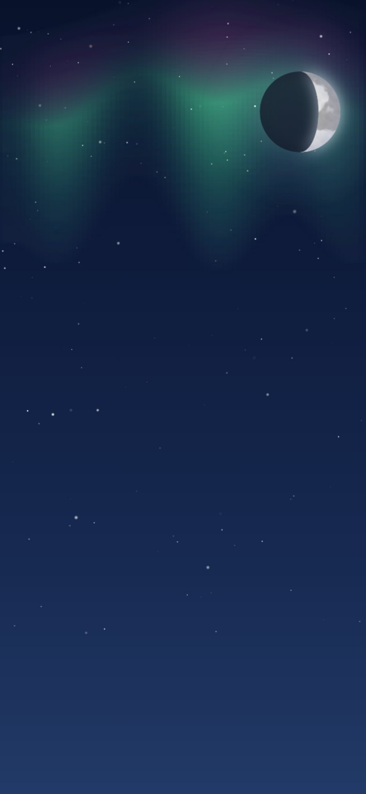 |

## Półprzezroczyste karty (opcjonalnie)

W domyślnym motywie Home Assistant karty są nieprzezroczyste, więc niebo widać między nimi i wokół nich, jak na zrzutach powyżej. Jeśli chcesz, żeby niebo prześwitywało przez karty, użyj motywu z półprzezroczystymi, rozmytymi kartami. Home Assistant obsługuje to natywnie przez zmienne motywu `ha-card-background` i `ha-card-backdrop-filter`.

| Półprzezroczyste karty, jasny | Półprzezroczyste karty, ciemny |
|---|---|
| 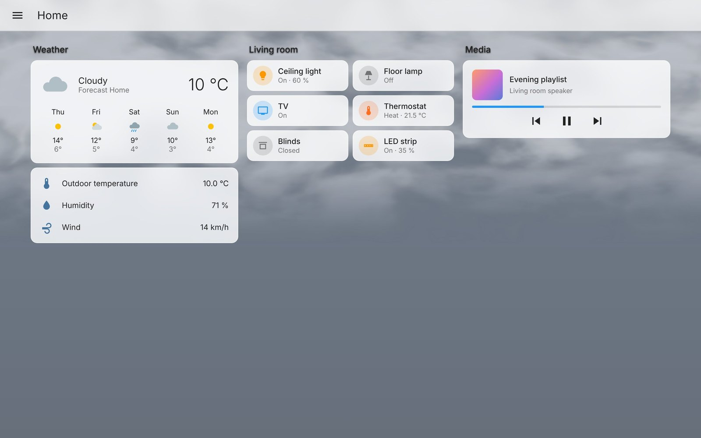 | 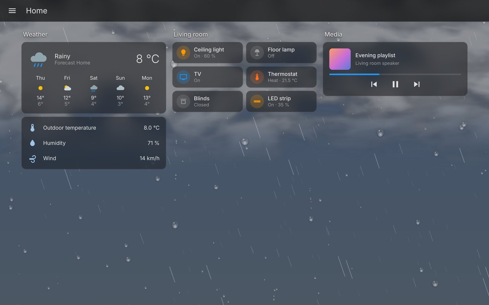 |

Dodaj to do folderu `themes` albo przenieś zmienne do własnego motywu:

```yaml
weather-glass:
  modes:
    light:
      ha-card-background: "rgba(255, 255, 255, calc(0.62 + var(--wbg-sky-dark, 0) * 0.25))"
      ha-card-backdrop-filter: "blur(18px) saturate(160%)"
      ha-card-border-color: "rgba(255, 255, 255, 0.55)"
    dark:
      ha-card-background: "rgba(28, 28, 28, calc(0.55 + var(--wbg-sky-light, 0) * 0.25))"
      ha-card-backdrop-filter: "blur(18px) saturate(160%)"
      ha-card-border-color: "rgba(255, 255, 255, 0.08)"
```

`calc()` sprawia, że karty stają się bardziej kryjące, gdy niebo za nimi nie pasuje do motywu, np. ciemne nocne niebo w motywie jasnym. Dzięki temu tekst pozostaje czytelny.

Jeśli jednolity pasek nagłówka zasłania górę nieba, ustaw też `app-header-background-color` na kolor półprzezroczysty.

## Zmienne CSS dla motywów

Gdy tło działa, karta ustawia na stronie zmienne:

| Zmienna | Wartość |
|---|---|
| `--wbg-active` | `1`, gdy tło jest pokazywane. |
| `--wbg-sky-dark` | Od `0` (jasne niebo) do `1` (ciemne niebo), już po korekcie motywu. |
| `--wbg-sky-light` | `1 − --wbg-sky-dark`. |
| `--wbg-reduce-transparency` | `1`, gdy system prosi o mniejszą przezroczystość. |

Możesz ich używać w dowolnym motywie albo z card-mod.

## Dostępność i wydajność

- Przy systemowym **Ogranicz ruch** karta pokazuje statyczną scenę bez błysków. Można to zmienić osobno dla każdego urządzenia.
- **Zmniejsz przezroczystość** jest przekazywane motywom przez `--wbg-reduce-transparency`.
- Animacja zatrzymuje się, gdy karta przeglądarki lub aplikacja jest w tle.
- Deszcz, śnieg i grad działają w ok. 30 kl./s (60 kl./s przy jakości *Wysokiej*), a chmury i gwiazdy w ok. 20 kl./s. Niebo bez niczego do animowania przestaje się przerysowywać.
- Tekstury chmur powstają raz, po kilka wierszy między klatkami, więc ładowanie dashboardu się nie zacina. Chmury pojawiają się płynnie, gdy są gotowe, zwykle w ciągu sekundy.
- Przy jakości *Automatycznej* karta mierzy koszt własnych klatek i zmniejsza liczbę cząsteczek na wolnych urządzeniach.
- Tło to kilka warstw canvas i gradientów. Nie są pobierane żadne obrazy.

## Rozwiązywanie problemów

**„Custom element doesn't exist: ha-weather-dynamic-background-card”**
Przeglądarka nie wczytała pliku.
- Sprawdź w HACS, czy **HA Weather Dynamic Background** jest pobrane.
- Otwórz `http://<adres-ha>:8123/hacsfiles/ha-weather-dynamic-background-card/ha-weather-dynamic-background-card.js`. Powinien pokazać się kod, a nie błąd.
- W **Ustawienia → Dashboardy → ⋮ → Zasoby** sprawdź, czy powyższy zasób jest na liście z typem *Moduł JavaScript*. Dashboardy w trybie YAML wymagają dodania go ręcznie.
- Wymuś odświeżenie przeglądarki lub wyczyść pamięć podręczną frontendu w aplikacji.

**Karta jest, ale tła nie ma**
- Otwórz panel w trybie edycji. Pojawiają się tam ostrzeżenia o brakującej encji albo tle wyłączonym na tym urządzeniu.
- Zajrzyj do konsoli przeglądarki (F12). Powinna tam być linia `HA-WEATHER-DYNAMIC-BACKGROUND-CARD 1.6.0`.

**Niebo zasłania jednolity kolor**
Motyw maluje tło widoku lub nagłówek pełnym kolorem. Zob. [Półprzezroczyste karty](#półprzezroczyste-karty-opcjonalnie).

**Przycina się na starym tablecie**
Ustaw w panelu na tym urządzeniu *Jakość → Oszczędna* albo *Animacje → Wyłączone*.

**Scena zmienia się za późno lub za często**
Zmień `hysteresis`, czyli liczbę minut, przez którą nowy stan musi się utrzymać.

## Ograniczenia

- Żeby znaleźć się za widokiem, karta wstawia swoją warstwę w strukturę frontendu Home Assistant, zaraz za tło widoku. Była tworzona pod frontend HA 2026.10. Starsze wersje nie były testowane, a przyszła przebudowa frontendu może wymagać aktualizacji karty.
- Tęcza korzysta z historii pogody zapamiętanej w przeglądarce. Po odświeżeniu strony karta nie wie, że przed chwilą padało.
- Stan pogody pochodzi z Twojej integracji. Wiele serwisów prognozy podaje bieżący stan z opóźnieniem.
- Chmury są u góry nieba. Przy domyślnych, nieprzezroczystych kartach na telefonie duża ich część chowa się za pierwszymi kartami; najlepiej widać je przez półprzezroczyste karty (zob. wyżej).
- To karta dekoracyjna. Nic w niej, łącznie z ostrzeżeniami, nie służy do podejmowania decyzji związanych z bezpieczeństwem.

## Podobne projekty

Dobre projekty z innym podejściem, bo animują pogodę wewnątrz karty, a nie za całym dashboardem:

- [Nimbus Weather Card](https://github.com/maxfok/nimbus-weather-card)
- [Atmospheric Weather Card](https://community.home-assistant.io/t/atmospheric-weather-card/981048)
